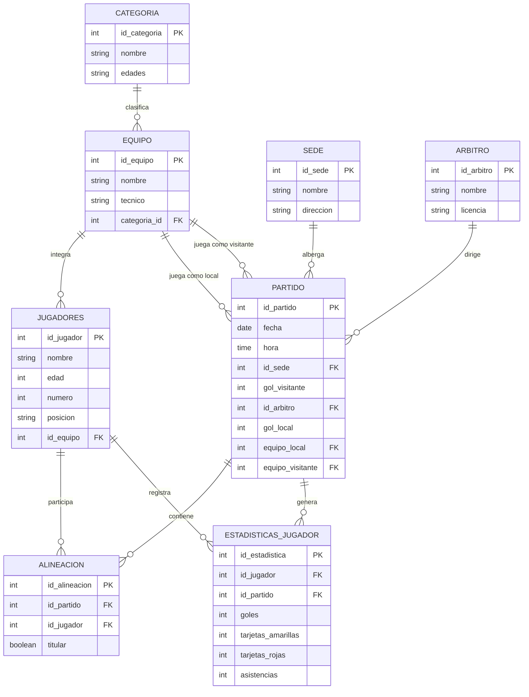

# ⚽ Sistema de Gestión de una Liga Infantil de Fútbol

## 1. Introducción

El presente proyecto tiene como finalidad desarrollar un sistema de información para la gestión y administración de una liga infantil de fútbol, mediante una aplicación web que permita organizar y consultar la información relacionada con los equipos participantes, jugadores, categorías, partidos, sedes y árbitros.

Se propone el diseño de una base de datos que permita almacenar y relacionar toda la información necesaria para el funcionamiento de la liga. El sistema contempla el registro de categorías, equipos y jugadores, así como la administración de partidos, asignación de árbitros, sedes, alineaciones y estadísticas individuales.

Con este proyecto se busca facilitar la administración de la liga infantil de fútbol, mejorar la organización de los encuentros deportivos y proporcionar un medio de consulta eficiente, confiable y ordenado.

---

## 2. Casos de uso (UML)

### 2.1 Actores del sistema

- **Administrador:** Administra categorías, equipos, jugadores, sedes, árbitros y partidos.
- **Entrenador:** Consulta la información de su equipo, jugadores, partidos y alineaciones.
- **Árbitro:** Participa en los encuentros y registra resultados y estadísticas.
- **Usuario / Consultor:** Consulta equipos, partidos, fechas, sedes y resultados.

### 2.2 Descripción de los casos de uso

| Caso de uso | Descripción | Actor principal |
|---|---|---|
| Gestionar categorías | Registrar, consultar, modificar y eliminar categorías. | Administrador |
| Gestionar equipos | Registrar equipos y asignar entrenadores. | Administrador |
| Gestionar jugadores | Registrar y administrar jugadores. | Administrador |
| Gestionar sedes | Registrar lugares donde se realizan los partidos. | Administrador |
| Gestionar árbitros | Registrar árbitros disponibles. | Administrador |
| Programar partidos | Establecer fecha, hora, sede y equipos. | Administrador |
| Registrar alineaciones | Seleccionar jugadores titulares y suplentes. | Administrador / Entrenador |
| Registrar resultados | Registrar goles del equipo local y visitante. | Administrador / Árbitro |
| Registrar estadísticas | Registrar goles, asistencias y tarjetas de cada jugador. | Administrador / Árbitro |
| Consultar partidos | Visualizar encuentros y resultados. | Todos |
| Consultar equipos y jugadores | Consultar equipos e integrantes. | Todos |
| Consultar estadísticas | Consultar estadísticas individuales y acumuladas. | Todos |

### 2.3 Diagrama de casos de uso


---

## 3. Modelo entidad-relación

### 3.1 Descripción de las entidades

El modelo entidad-relación está compuesto por ocho entidades principales.

#### 1. Categoría

| Atributo | Tipo de dato | Clave |
|---|---|---|
| id_categoria | INT | PK |
| nombre | VARCHAR(100) | |
| edades | VARCHAR(50) | |

#### 2. Equipo

| Atributo | Tipo de dato | Clave |
|---|---|---|
| id_equipo | INT | PK |
| nombre | VARCHAR(120) | |
| tecnico | VARCHAR(120) | |
| categoria_id | INT | FK |

#### 3. Jugadores

| Atributo | Tipo de dato | Clave |
|---|---|---|
| id_jugador | INT | PK |
| nombre | VARCHAR(150) | |
| edad | INT | |
| numero | INT | |
| posicion | VARCHAR(50) | |
| id_equipo | INT | FK |

#### 4. Sede

| Atributo | Tipo de dato | Clave |
|---|---|---|
| id_sede | INT | PK |
| nombre | VARCHAR(120) | |
| direccion | VARCHAR(250) | |

#### 5. Árbitro

| Atributo | Tipo de dato | Clave |
|---|---|---|
| id_arbitro | INT | PK |
| nombre | VARCHAR(150) | |
| licencia | VARCHAR(80) | |

#### 6. Alineación

| Atributo | Tipo de dato | Clave |
|---|---|---|
| id_alineacion | INT | PK |
| id_partido | INT | FK |
| id_jugador | INT | FK |
| titular | BOOLEAN | |

#### 7. Partido

| Atributo | Tipo de dato | Clave |
|---|---|---|
| id_partido | INT | PK |
| fecha | DATE | |
| hora | TIME | |
| id_sede | INT | FK |
| gol_visitante | INT | |
| id_arbitro | INT | FK |
| gol_local | INT | |
| equipo_local | INT | FK |
| equipo_visitante | INT | FK |

#### 8. Estadísticas del jugador

| Atributo | Tipo de dato | Clave |
|---|---|---|
| id_estadistica | INT | PK |
| id_jugador | INT | FK |
| id_partido | INT | FK |
| goles | INT | |
| tarjetas_amarillas | INT | |
| tarjetas_rojas | INT | |
| asistencias | INT | |

Esta tabla permite registrar el rendimiento individual de cada jugador en cada partido, incluyendo goles, tarjetas amarillas, tarjetas rojas y asistencias.

Los datos se pueden acumular para consultar el rendimiento de cada jugador durante toda la temporada.

### 3.2 Diagrama entidad-relación



### 3.3 Descripción de las relaciones

- **Categoría - Equipo (1:N):** Una categoría puede tener varios equipos, pero cada equipo pertenece a una categoría.
- **Equipo - Jugadores (1:N):** Un equipo puede tener varios jugadores.
- **Equipo - Partido como local (1:N):** Un equipo puede jugar varios partidos como local.
- **Equipo - Partido como visitante (1:N):** Un equipo puede jugar varios partidos como visitante.
- **Sede - Partido (1:N):** Una sede puede albergar varios partidos.
- **Árbitro - Partido (1:N):** Un árbitro puede dirigir varios partidos.
- **Partido - Alineación (1:N):** Un partido puede tener varios registros de alineación.
- **Jugador - Alineación (1:N):** Un jugador puede aparecer en distintas alineaciones.
- **Jugador - Estadísticas (1:N):** Un jugador puede tener estadísticas en diferentes partidos.
- **Partido - Estadísticas (1:N):** Un partido puede generar estadísticas para varios jugadores.

---

## 4. Creación de la base de datos en PostgreSQL

### 4.1 Crear la base de datos

```sql
CREATE DATABASE "LigaFutbol";
```

Después, conectarse a la base de datos `LigaFutbol` para crear las tablas.

### 4.2 Código SQL de las ocho tablas

```sql
-- =========================================
-- BASE DE DATOS: LigaFutbol
-- SISTEMA DE GESTION DE LIGA INFANTIL
-- PostgreSQL 18
-- =========================================

-- 1. TABLA CATEGORIA
CREATE TABLE categoria (
    id_categoria INTEGER GENERATED ALWAYS AS IDENTITY PRIMARY KEY,
    nombre VARCHAR(100) NOT NULL UNIQUE,
    edades VARCHAR(50) NOT NULL
);

-- 2. TABLA EQUIPO
CREATE TABLE equipo (
    id_equipo INTEGER GENERATED ALWAYS AS IDENTITY PRIMARY KEY,
    nombre VARCHAR(120) NOT NULL,
    tecnico VARCHAR(120) NOT NULL,
    categoria_id INTEGER NOT NULL,

    CONSTRAINT fk_equipo_categoria
        FOREIGN KEY (categoria_id)
        REFERENCES categoria(id_categoria)
        ON UPDATE CASCADE
        ON DELETE RESTRICT,

    CONSTRAINT uq_equipo_categoria
        UNIQUE (nombre, categoria_id)
);

-- 3. TABLA JUGADORES
CREATE TABLE jugadores (
    id_jugador INTEGER GENERATED ALWAYS AS IDENTITY PRIMARY KEY,
    nombre VARCHAR(150) NOT NULL,
    edad INTEGER NOT NULL CHECK (edad BETWEEN 3 AND 18),
    numero INTEGER NOT NULL CHECK (numero BETWEEN 0 AND 99),
    posicion VARCHAR(50),
    id_equipo INTEGER NOT NULL,

    CONSTRAINT fk_jugador_equipo
        FOREIGN KEY (id_equipo)
        REFERENCES equipo(id_equipo)
        ON UPDATE CASCADE
        ON DELETE RESTRICT,

    CONSTRAINT uq_numero_equipo
        UNIQUE (id_equipo, numero)
);

-- 4. TABLA SEDE
CREATE TABLE sede (
    id_sede INTEGER GENERATED ALWAYS AS IDENTITY PRIMARY KEY,
    nombre VARCHAR(120) NOT NULL UNIQUE,
    direccion VARCHAR(250) NOT NULL
);

-- 5. TABLA ARBITRO
CREATE TABLE arbitro (
    id_arbitro INTEGER GENERATED ALWAYS AS IDENTITY PRIMARY KEY,
    nombre VARCHAR(150) NOT NULL,
    licencia VARCHAR(80) NOT NULL UNIQUE
);

-- 6. TABLA PARTIDO
CREATE TABLE partido (
    id_partido INTEGER GENERATED ALWAYS AS IDENTITY PRIMARY KEY,
    fecha DATE NOT NULL,
    hora TIME NOT NULL,
    id_sede INTEGER NOT NULL,
    gol_visitante INTEGER CHECK (gol_visitante >= 0),
    id_arbitro INTEGER NOT NULL,
    gol_local INTEGER CHECK (gol_local >= 0),
    equipo_local INTEGER NOT NULL,
    equipo_visitante INTEGER NOT NULL,

    CONSTRAINT fk_partido_sede
        FOREIGN KEY (id_sede)
        REFERENCES sede(id_sede)
        ON UPDATE CASCADE
        ON DELETE RESTRICT,

    CONSTRAINT fk_partido_arbitro
        FOREIGN KEY (id_arbitro)
        REFERENCES arbitro(id_arbitro)
        ON UPDATE CASCADE
        ON DELETE RESTRICT,

    CONSTRAINT fk_partido_local
        FOREIGN KEY (equipo_local)
        REFERENCES equipo(id_equipo)
        ON UPDATE CASCADE
        ON DELETE RESTRICT,

    CONSTRAINT fk_partido_visitante
        FOREIGN KEY (equipo_visitante)
        REFERENCES equipo(id_equipo)
        ON UPDATE CASCADE
        ON DELETE RESTRICT,

    CONSTRAINT chk_equipos_diferentes
        CHECK (equipo_local <> equipo_visitante)
);

-- 7. TABLA ALINEACION
CREATE TABLE alineacion (
    id_alineacion INTEGER GENERATED ALWAYS AS IDENTITY PRIMARY KEY,
    id_partido INTEGER NOT NULL,
    id_jugador INTEGER NOT NULL,
    titular BOOLEAN NOT NULL DEFAULT FALSE,

    CONSTRAINT fk_alineacion_partido
        FOREIGN KEY (id_partido)
        REFERENCES partido(id_partido)
        ON UPDATE CASCADE
        ON DELETE CASCADE,

    CONSTRAINT fk_alineacion_jugador
        FOREIGN KEY (id_jugador)
        REFERENCES jugadores(id_jugador)
        ON UPDATE CASCADE
        ON DELETE RESTRICT,

    CONSTRAINT uq_jugador_partido
        UNIQUE (id_partido, id_jugador)
);

-- 8. TABLA ESTADISTICAS_JUGADOR
CREATE TABLE estadisticas_jugador (
    id_estadistica INTEGER GENERATED ALWAYS AS IDENTITY PRIMARY KEY,
    id_jugador INTEGER NOT NULL,
    id_partido INTEGER NOT NULL,

    goles INTEGER NOT NULL DEFAULT 0
        CHECK (goles >= 0),

    tarjetas_amarillas INTEGER NOT NULL DEFAULT 0
        CHECK (tarjetas_amarillas >= 0),

    tarjetas_rojas INTEGER NOT NULL DEFAULT 0
        CHECK (tarjetas_rojas >= 0),

    asistencias INTEGER NOT NULL DEFAULT 0
        CHECK (asistencias >= 0),

    CONSTRAINT fk_estadistica_jugador
        FOREIGN KEY (id_jugador)
        REFERENCES jugadores(id_jugador)
        ON UPDATE CASCADE
        ON DELETE RESTRICT,

    CONSTRAINT fk_estadistica_partido
        FOREIGN KEY (id_partido)
        REFERENCES partido(id_partido)
        ON UPDATE CASCADE
        ON DELETE CASCADE,

    CONSTRAINT uq_estadistica_jugador_partido
        UNIQUE (id_jugador, id_partido)
);

-- =========================================
-- INDICES PARA MEJORAR LAS CONSULTAS
-- =========================================

CREATE INDEX idx_equipo_categoria
    ON equipo(categoria_id);

CREATE INDEX idx_jugadores_equipo
    ON jugadores(id_equipo);

CREATE INDEX idx_partido_fecha
    ON partido(fecha);

CREATE INDEX idx_partido_local
    ON partido(equipo_local);

CREATE INDEX idx_partido_visitante
    ON partido(equipo_visitante);

CREATE INDEX idx_alineacion_partido
    ON alineacion(id_partido);

CREATE INDEX idx_alineacion_jugador
    ON alineacion(id_jugador);

CREATE INDEX idx_estadisticas_jugador
    ON estadisticas_jugador(id_jugador);

CREATE INDEX idx_estadisticas_partido
    ON estadisticas_jugador(id_partido);
```

---

## 5. Ejemplo de registro de estadísticas

Para registrar las estadísticas de los jugadores en un partido:

```sql
INSERT INTO estadisticas_jugador
    (id_jugador, id_partido, goles,
     tarjetas_amarillas, tarjetas_rojas, asistencias)
VALUES
    (1, 1, 2, 0, 0, 1),
    (2, 1, 0, 1, 0, 0),
    (3, 1, 1, 0, 0, 2);
```

---

## 6. Consultas de la base de datos

### 6.1 Consultar equipos y categorías

```sql
SELECT
    c.nombre AS categoria,
    e.nombre AS equipo,
    e.tecnico
FROM categoria c
INNER JOIN equipo e
    ON c.id_categoria = e.categoria_id;
```

### 6.2 Consultar jugadores y sus equipos

```sql
SELECT
    j.id_jugador,
    j.nombre AS jugador,
    j.edad,
    j.numero,
    j.posicion,
    e.nombre AS equipo
FROM jugadores j
INNER JOIN equipo e
    ON j.id_equipo = e.id_equipo;
```

### 6.3 Consultar calendario de partidos

```sql
SELECT
    p.id_partido,
    p.fecha,
    p.hora,
    el.nombre AS equipo_local,
    ev.nombre AS equipo_visitante,
    p.gol_local,
    p.gol_visitante,
    s.nombre AS sede,
    a.nombre AS arbitro
FROM partido p
INNER JOIN equipo el
    ON p.equipo_local = el.id_equipo
INNER JOIN equipo ev
    ON p.equipo_visitante = ev.id_equipo
INNER JOIN sede s
    ON p.id_sede = s.id_sede
INNER JOIN arbitro a
    ON p.id_arbitro = a.id_arbitro
ORDER BY p.fecha, p.hora;
```

### 6.4 Consultar alineaciones

```sql
SELECT
    p.id_partido,
    j.nombre AS jugador,
    e.nombre AS equipo,
    a.titular
FROM alineacion a
INNER JOIN jugadores j
    ON a.id_jugador = j.id_jugador
INNER JOIN equipo e
    ON j.id_equipo = e.id_equipo
INNER JOIN partido p
    ON a.id_partido = p.id_partido
WHERE p.id_partido = 1;
```

### 6.5 Consultar estadísticas acumuladas de cada jugador

```sql
SELECT
    j.id_jugador,
    j.nombre AS jugador,
    e.nombre AS equipo,
    COALESCE(SUM(est.goles), 0) AS total_goles,
    COALESCE(SUM(est.tarjetas_amarillas), 0) AS total_amarillas,
    COALESCE(SUM(est.tarjetas_rojas), 0) AS total_rojas,
    COALESCE(SUM(est.asistencias), 0) AS total_asistencias
FROM jugadores j
INNER JOIN equipo e
    ON j.id_equipo = e.id_equipo
LEFT JOIN estadisticas_jugador est
    ON j.id_jugador = est.id_jugador
GROUP BY
    j.id_jugador,
    j.nombre,
    e.nombre
ORDER BY total_goles DESC, j.nombre;
```

---

## 7. Conclusión

El diseño de la base de datos permite organizar y administrar la información de una liga infantil de fútbol mediante ocho entidades relacionadas entre sí.

La incorporación de la tabla **Estadísticas del Jugador** amplía las funcionalidades del sistema, ya que permite llevar un registro individual de goles, tarjetas amarillas, tarjetas rojas y asistencias por encuentro deportivo.

De esta manera, se pueden generar estadísticas acumuladas, identificar a los máximos goleadores y consultar el rendimiento de cada jugador durante la temporada.

El sistema proporciona una estructura organizada para facilitar la administración de los equipos, jugadores, encuentros y resultados de la liga.

---

**Tecnología utilizada:** PostgreSQL 18  
**Nombre de la base de datos:** LigaFutbol  
**Total de entidades:** 8

