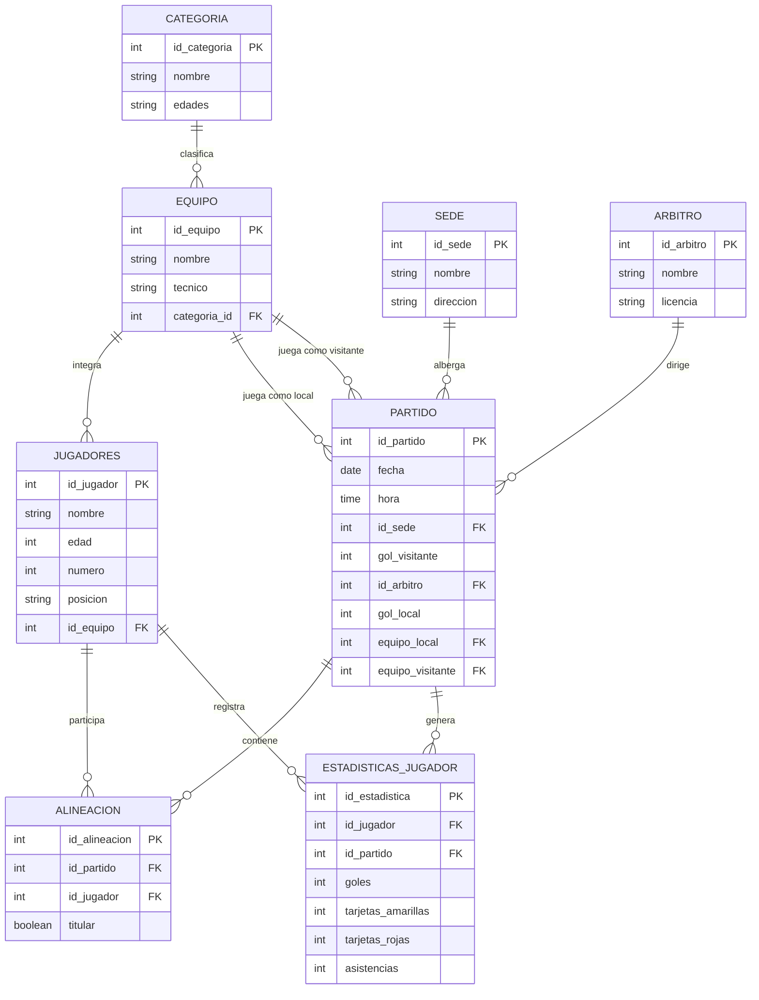

# Sistema de Gestión de una Liga Infantil de Fútbol

## 1. Introducción

El presente proyecto tiene como finalidad desarrollar un sistema de información para la gestión y administración de una liga infantil de fútbol, mediante una aplicación web que permita organizar y consultar la información relacionada con los equipos participantes, jugadores, categorías, partidos, sedes y árbitros.

Actualmente, la organización de una liga deportiva requiere llevar un control adecuado de los equipos inscritos, sus integrantes, las categorías correspondientes y la programación de los encuentros deportivos. Cuando esta información se administra de manera manual o mediante diferentes medios, pueden presentarse problemas como duplicidad de datos, pérdida de información y dificultades para consultar los resultados de los partidos.

Por esta razón, se propone el diseño de una base de datos que permita almacenar y relacionar toda la información necesaria para el funcionamiento de la liga. El sistema contempla el registro de categorías, equipos y jugadores, así como la administración de partidos, asignación de árbitros, sedes y alineaciones de los jugadores.

Además, se plantea una arquitectura que permita acceder al sistema mediante una aplicación web y dispositivos móviles, utilizando una base de datos para centralizar la información y contemplando mecanismos de respaldo y replicación para mantener disponibles los datos.

Con este proyecto se busca facilitar la administración de la liga infantil de fútbol, mejorar la organización de los encuentros deportivos y proporcionar un medio de consulta más eficiente, confiable y ordenado para los usuarios.

---

## 2. Casos de uso (UML)

### 2.1 Actores del sistema

- **Administrador de la liga:** Responsable de administrar la información general del sistema, registrar categorías, equipos, jugadores y programar los partidos.
- **Entrenador:** Puede consultar la información de su equipo y sus jugadores, así como revisar los partidos programados y las alineaciones.
- **Árbitro:** Participa en los encuentros deportivos asignados y proporciona la información correspondiente a los resultados.
- **Usuario / Consultor:** Puede consultar información general de la liga, como equipos participantes, partidos, fechas, sedes y resultados.

### 2.2 Descripción de los casos de uso

| Caso de uso | Descripción | Actor principal |
|---|---|---|
| Gestionar categorías | Registrar, consultar, modificar y eliminar categorías de la liga. | Administrador |
| Gestionar equipos | Registrar equipos, asignar entrenadores y relacionarlos con una categoría. | Administrador |
| Gestionar jugadores | Registrar jugadores, asignarlos a equipos y administrar sus datos. | Administrador |
| Gestionar sedes | Registrar y consultar los lugares donde se realizarán los partidos. | Administrador |
| Gestionar árbitros | Registrar y consultar los árbitros disponibles para los encuentros. | Administrador |
| Programar partidos | Establecer fecha, hora, sede, equipo local y equipo visitante. | Administrador |
| Registrar alineaciones | Seleccionar los jugadores que participarán en un partido e indicar si son titulares. | Administrador / Entrenador |
| Registrar resultados | Registrar los goles del equipo local y visitante. | Administrador |
| Registrar estadísticas | Registrar goles, tarjetas amarillas, tarjetas rojas y asistencias de cada jugador. | Administrador / Árbitro |
| Consultar estadísticas | Visualizar las estadísticas individuales de los jugadores. | Todos los usuarios |
| Consultar partidos | Visualizar los encuentros programados y sus resultados. | Todos los usuarios |
| Consultar equipos y jugadores | Consultar los equipos participantes y sus integrantes. | Todos los usuarios |

### 2.3 Diagrama de casos de uso

```mermaid
flowchart TB
    A["Administrador de la liga"]
    E["Entrenador"]
    R["Árbitro"]
    U["Usuario / Consultor"]

    subgraph S["Sistema de Gestión de Liga Infantil de Fútbol"]
        UC1(["Gestionar categorías"])
        UC2(["Gestionar equipos"])
        UC3(["Gestionar jugadores"])
        UC4(["Gestionar sedes"])
        UC5(["Gestionar árbitros"])
        UC6(["Programar partidos"])
        UC7(["Registrar alineaciones"])
        UC8(["Registrar resultados"])
        UC9(["Registrar estadísticas"])
        UC10(["Consultar estadísticas"])
        UC11(["Consultar partidos"])
        UC12(["Consultar equipos y jugadores"])
    end

    A --- UC1
    A --- UC2
    A --- UC3
    A --- UC4
    A --- UC5
    A --- UC6
    A --- UC7
    A --- UC8
    A --- UC9

    E --- UC11
    E --- UC12
    E --- UC7
    E --- UC10

    R --- UC8
    R --- UC9

    U --- UC10
    U --- UC11
    U --- UC12
```



---

## 3. Modelo entidad-relación

### 3.1 Descripción de las entidades

El modelo entidad-relación está compuesto por ocho entidades principales que permiten representar la información necesaria para administrar la liga infantil de fútbol.

**1. Categoría**

| Atributo | Tipo de dato | Clave |
|---|---|---|
| id_categoria | INT | PK |
| nombre | VARCHAR | |
| edades | VARCHAR | |

**2. Equipo**

| Atributo | Tipo de dato | Clave |
|---|---|---|
| id_equipo | INT | PK |
| nombre | VARCHAR | |
| tecnico | VARCHAR | |
| categoria_id | INT | FK |

**3. Jugadores**

| Atributo | Tipo de dato | Clave |
|---|---|---|
| id_jugador | INT | PK |
| nombre | VARCHAR | |
| edad | INT | |
| numero | INT | |
| posicion | VARCHAR | |
| id_equipo | INT | FK |

**4. Sede**

| Atributo | Tipo de dato | Clave |
|---|---|---|
| id_sede | INT | PK |
| nombre | VARCHAR | |
| direccion | VARCHAR | |

**5. Árbitro**

| Atributo | Tipo de dato | Clave |
|---|---|---|
| id_arbitro | INT | PK |
| nombre | VARCHAR | |
| licencia | VARCHAR | |

**6. Alineación**

| Atributo | Tipo de dato | Clave |
|---|---|---|
| id_alineacion | INT | PK |
| id_partido | INT | FK |
| id_jugador | INT | FK |
| titular | BOOLEAN | |

**7. Partido**

| Atributo | Tipo de dato | Clave |
|---|---|---|
| id_partido | INT | PK |
| fecha | DATE | |
| hora | TIME | |
| id_sede | INT | FK |
| gol_visitante | INT | |
| id_arbitro | INT | FK |
| gol_local | INT | |
| equipo_local | INT | FK |
| equipo_visitante | INT | FK |

**8. Estadísticas del jugador**

| Atributo | Tipo de dato | Clave |
|---|---|---|
| id_estadistica | INT | PK |
| id_jugador | INT | FK |
| id_partido | INT | FK |
| goles | INT | |
| tarjetas_amarillas | INT | |
| tarjetas_rojas | INT | |
| asistencias | INT | |

### 3.2 Diagrama entidad-relación



### 3.3 Descripción de las relaciones

- **Categoría - Equipo (1:N):** Una categoría puede tener varios equipos registrados, pero cada equipo pertenece a una sola categoría.
- **Equipo - Jugadores (1:N):** Un equipo puede estar integrado por varios jugadores, pero cada jugador pertenece a un equipo.
- **Equipo - Partido como local (1:N):** Un equipo puede participar en diferentes partidos como equipo local.
- **Equipo - Partido como visitante (1:N):** Un equipo puede participar en diferentes partidos como equipo visitante.
- **Sede - Partido (1:N):** Una sede puede albergar diferentes partidos, pero cada partido se realiza en una sola sede.
- **Árbitro - Partido (1:N):** Un árbitro puede dirigir varios partidos, pero cada partido tiene asignado un árbitro.
- **Partido - Alineación (1:N):** Un partido puede tener varias alineaciones correspondientes a los jugadores participantes.
- **Jugador - Alineación (1:N):** Un jugador puede aparecer en diferentes alineaciones a lo largo de distintos partidos.
- **Jugador - Estadísticas (1:N):** Un jugador puede tener diferentes registros estadísticos en distintos partidos.
- **Partido - Estadísticas (1:N):** Un partido puede contener estadísticas de varios jugadores.

---

## 4. Código SQL de la nueva tabla

La siguiente tabla se agrega a las siete tablas originales para llevar el control de las estadísticas individuales de los jugadores.

```sql
CREATE TABLE estadisticas_jugador (
    id_estadistica INTEGER GENERATED ALWAYS AS IDENTITY PRIMARY KEY,
    id_jugador INTEGER NOT NULL,
    id_partido INTEGER NOT NULL,
    goles INTEGER NOT NULL DEFAULT 0 CHECK (goles >= 0),
    tarjetas_amarillas INTEGER NOT NULL DEFAULT 0 CHECK (tarjetas_amarillas >= 0),
    tarjetas_rojas INTEGER NOT NULL DEFAULT 0 CHECK (tarjetas_rojas >= 0),
    asistencias INTEGER NOT NULL DEFAULT 0 CHECK (asistencias >= 0),

    FOREIGN KEY (id_jugador)
        REFERENCES jugadores(id_jugador),

    FOREIGN KEY (id_partido)
        REFERENCES partido(id_partido),

    UNIQUE (id_jugador, id_partido)
);
```
