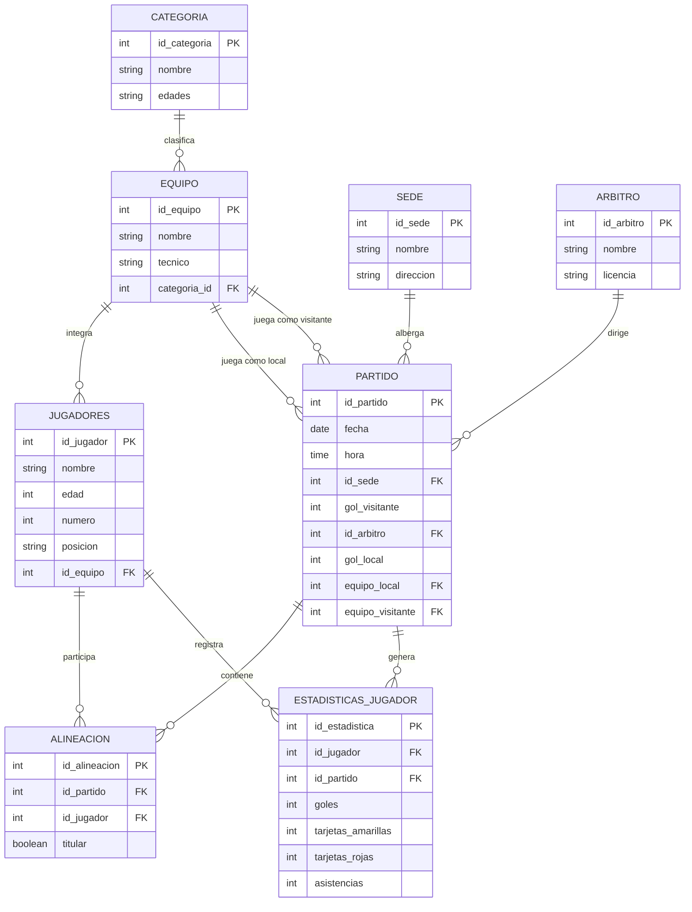

# Sistema de Gestión de una Liga Infantil de Fútbol ⚽

## 1. Introducción

El presente proyecto tiene como finalidad desarrollar un sistema de información para la gestión y administración de una liga infantil de fútbol, mediante una aplicación web que permita organizar y consultar la información relacionada con los equipos participantes, jugadores, categorías, partidos, sedes y árbitros.

Actualmente, la organización de una liga deportiva requiere llevar un control adecuado de los equipos inscritos, sus integrantes, las categorías correspondientes y la programación de los encuentros deportivos. Cuando esta información se administra de manera manual o mediante diferentes medios, pueden presentarse problemas como duplicidad de datos, pérdida de información y dificultades para consultar los resultados de los partidos.

Por esta razón, se propone el diseño de una base de datos que permita almacenar y relacionar toda la información necesaria para el funcionamiento de la liga. El sistema contempla el registro de categorías, equipos y jugadores, así como la administración de partidos, asignación de árbitros, sedes, alineaciones y estadísticas individuales de los jugadores.

Además, se plantea una arquitectura que permita acceder al sistema mediante una aplicación web y dispositivos móviles, utilizando una base de datos para centralizar la información y contemplando mecanismos de respaldo y replicación para mantener disponibles los datos.

Con este proyecto se busca facilitar la administración de la liga infantil de fútbol, mejorar la organización de los encuentros deportivos y proporcionar un medio de consulta más eficiente, confiable y ordenado para los usuarios.

---

# 2. Casos de uso (UML)

## 2.1 Actores del sistema

- **Administrador de la liga:** Responsable de administrar la información general del sistema, registrar categorías, equipos, jugadores y programar los partidos.
- **Entrenador:** Puede consultar la información de su equipo y sus jugadores, así como revisar los partidos programados y las alineaciones.
- **Árbitro:** Participa en los encuentros deportivos asignados y proporciona la información correspondiente a los resultados y estadísticas de los jugadores.
- **Usuario / Consultor:** Puede consultar información general de la liga, como equipos participantes, partidos, fechas, sedes, resultados y estadísticas de los jugadores.

## 2.2 Descripción de los casos de uso

| Caso de uso | Descripción | Actor principal |
|---|---|---|
| Gestionar categorías | Registrar, consultar, modificar y eliminar categorías de la liga. | Administrador |
| Gestionar equipos | Registrar equipos, asignar entrenadores y relacionarlos con una categoría. | Administrador |
| Gestionar jugadores | Registrar jugadores, asignarlos a equipos y administrar sus datos. | Administrador |
| Gestionar sedes | Registrar y consultar los lugares donde se realizarán los partidos. | Administrador |
| Gestionar árbitros | Registrar y consultar los árbitros disponibles para los encuentros. | Administrador |
| Programar partidos | Establecer fecha, hora, sede, equipo local y equipo visitante. | Administrador |
| Registrar alineaciones | Seleccionar los jugadores que participarán en un partido e indicar si son titulares. | Administrador / Entrenador |
| Registrar resultados | Registrar los goles del equipo local y visitante. | Administrador / Árbitro |
| Registrar estadísticas | Registrar los goles, tarjetas amarillas, tarjetas rojas y asistencias de cada jugador por partido. | Administrador / Árbitro |
| Consultar estadísticas | Visualizar las estadísticas individuales y acumuladas de los jugadores. | Todos los usuarios |
| Consultar partidos | Visualizar los encuentros programados y sus resultados. | Todos los usuarios |
| Consultar equipos y jugadores | Consultar los equipos participantes y sus integrantes. | Todos los usuarios |

## 2.3 Diagrama de casos de uso

```mermaid
flowchart TB
    A["Administrador de la liga"]
    E["Entrenador"]
    R["Árbitro"]
    U["Usuario / Consultor"]

    subgraph S["Sistema de Gestión de Liga Infantil de Fútbol"]
        UC1(["Gestionar categorías"])
        UC2(["Gestionar equipos"])
        UC3(["Gestionar jugadores"])
        UC4(["Gestionar sedes"])
        UC5(["Gestionar árbitros"])
        UC6(["Programar partidos"])
        UC7(["Registrar alineaciones"])
        UC8(["Registrar resultados"])
        UC9(["Registrar estadísticas"])
        UC10(["Consultar partidos"])
        UC11(["Consultar equipos y jugadores"])
        UC12(["Consultar estadísticas"])
    end

    A --- UC1
    A --- UC2
    A --- UC3
    A --- UC4
    A --- UC5
    A --- UC6
    A --- UC7
    A --- UC8
    A --- UC9

    E --- UC7
    E --- UC10
    E --- UC11
    E --- UC12

    R --- UC8
    R --- UC9

    U --- UC10
    U --- UC11
    U --- UC12
```



---

# 3. Modelo entidad-relación

## 3.1 Descripción de las entidades

El modelo entidad-relación está compuesto por ocho entidades principales que permiten representar la información necesaria para administrar la liga infantil de fútbol.

### 1. Categoría

| Atributo | Tipo de dato | Clave |
|---|---|---|
| id_categoria | INT | PK |
| nombre | VARCHAR(100) | |
| edades | VARCHAR(50) | |

### 2. Equipo

| Atributo | Tipo de dato | Clave |
|---|---|---|
| id_equipo | INT | PK |
| nombre | VARCHAR(120) | |
| tecnico | VARCHAR(120) | |
| categoria_id | INT | FK |

### 3. Jugadores

| Atributo | Tipo de dato | Clave |
|---|---|---|
| id_jugador | INT | PK |
| nombre | VARCHAR(150) | |
| edad | INT | |
| numero | INT | |
| posicion | VARCHAR(50) | |
| id_equipo | INT | FK |

### 4. Sede

| Atributo | Tipo de dato | Clave |
|---|---|---|
| id_sede | INT | PK |
| nombre | VARCHAR(120) | |
| direccion | VARCHAR(250) | |

### 5. Árbitro

| Atributo | Tipo de dato | Clave |
|---|---|---|
| id_arbitro | INT | PK |
| nombre | VARCHAR(150) | |
| licencia | VARCHAR(80) | |

### 6. Alineación

| Atributo | Tipo de dato | Clave |
|---|---|---|
| id_alineacion | INT | PK |
| id_partido | INT | FK |
| id_jugador | INT | FK |
| titular | BOOLEAN | |

### 7. Partido

| Atributo | Tipo de dato | Clave |
|---|---|---|
| id_partido | INT | PK |
| fecha | DATE | |
| hora | TIME | |
| id_sede | INT | FK |
| gol_visitante | INT | |
| id_arbitro | INT | FK |
| gol_local | INT | |
| equipo_local | INT | FK |
| equipo_visitante | INT | FK |

### 8. Estadísticas del jugador

Esta nueva entidad permite llevar un control individual del rendimiento de cada jugador durante los encuentros deportivos de la liga.

| Atributo | Tipo de dato | Clave |
|---|---|---|
| id_estadistica | INT | PK |
| id_jugador | INT | FK |
| id_partido | INT | FK |
| goles | INT | |
| tarjetas_amarillas | INT | |
| tarjetas_rojas | INT | |
| asistencias | INT | |

**Descripción de los campos:**

- **id_estadistica:** Identificador único del registro estadístico.
- **id_jugador:** Identifica al jugador al que pertenecen las estadísticas.
- **id_partido:** Identifica el partido en el que se generaron las estadísticas.
- **goles:** Cantidad de goles anotados por el jugador.
- **tarjetas_amarillas:** Cantidad de tarjetas amarillas recibidas.
- **tarjetas_rojas:** Cantidad de tarjetas rojas recibidas.
- **asistencias:** Cantidad de asistencias realizadas por el jugador.

Las estadísticas se registran por partido para posteriormente obtener los totales acumulados de cada jugador durante la temporada.

## 3.2 Diagrama entidad-relación actualizado



## 3.3 Descripción de las relaciones

- **Categoría - Equipo (1:N):** Una categoría puede tener varios equipos registrados, pero cada equipo pertenece a una sola categoría.
- **Equipo - Jugadores (1:N):** Un equipo puede estar integrado por varios jugadores, pero cada jugador pertenece a un equipo.
- **Equipo - Partido como local (1:N):** Un equipo puede participar en diferentes partidos como equipo local.
- **Equipo - Partido como visitante (1:N):** Un equipo puede participar en diferentes partidos como equipo visitante.
- **Sede - Partido (1:N):** Una sede puede albergar diferentes partidos, pero cada partido se realiza en una sola sede.
- **Árbitro - Partido (1:N):** Un árbitro puede dirigir varios partidos, pero cada partido tiene asignado un árbitro.
- **Partido - Alineación (1:N):** Un partido puede tener varias alineaciones correspondientes a los jugadores participantes.
- **Jugador - Alineación (1:N):** Un jugador puede aparecer en diferentes alineaciones a lo largo de distintos partidos.
- **Jugador - Estadísticas (1:N):** Un jugador puede tener diferentes registros estadísticos, correspondientes a los partidos en los que participa.
- **Partido - Estadísticas (1:N):** Un partido puede generar registros estadísticos para varios jugadores.

---

# 4. Creación de la base de datos en PostgreSQL

## 4.1 Crear la base de datos

```sql
CREATE DATABASE "LigaFutbol";
```

Después de crearla, es necesario conectarse a la base de datos `LigaFutbol` para ejecutar las instrucciones de creación de tablas.

## 4.2 Código SQL de las ocho tablas

```sql
-- =========================================
-- BASE DE DATOS: LigaFutbol
-- SISTEMA DE GESTION DE LIGA INFANTIL
-- POSTGRESQL 18
-- =========================================

-- 1. TABLA CATEGORIA

CREATE TABLE categoria (
    id_categoria INTEGER GENERATED ALWAYS AS IDENTITY PRIMARY KEY,
    nombre VARCHAR(100) NOT NULL UNIQUE,
    edades VARCHAR(50) NOT NULL
);

-- 2. TABLA EQUIPO

CREATE TABLE equipo (
    id_equipo INTEGER GENERATED ALWAYS AS IDENTITY PRIMARY KEY,
    nombre VARCHAR(120) NOT NULL,
    tecnico VARCHAR(120) NOT NULL,
    categoria_id INTEGER NOT NULL,

    CONSTRAINT fk_equipo_categoria
        FOREIGN KEY (categoria_id)
        REFERENCES categoria(id_categoria)
        ON UPDATE CASCADE
        ON DELETE RESTRICT,

    CONSTRAINT uq_equipo_categoria
        UNIQUE (nombre, categoria_id)
);

-- 3. TABLA JUGADORES

CREATE TABLE jugadores (
    id_jugador INTEGER GENERATED ALWAYS AS IDENTITY PRIMARY KEY,
    nombre VARCHAR(150) NOT NULL,
    edad INTEGER NOT NULL CHECK (edad BETWEEN 3 AND 18),
    numero INTEGER NOT NULL CHECK (numero BETWEEN 0 AND 99),
    posicion VARCHAR(50),
    id_equipo INTEGER NOT NULL,

    CONSTRAINT fk_jugador_equipo
        FOREIGN KEY (id_equipo)
        REFERENCES equipo(id_equipo)
        ON UPDATE CASCADE
        ON DELETE RESTRICT,

    CONSTRAINT uq_numero_equipo
        UNIQUE (id_equipo, numero)
);

-- 4. TABLA SEDE

CREATE TABLE sede (
    id_sede INTEGER GENERATED ALWAYS AS IDENTITY PRIMARY KEY,
    nombre VARCHAR(120) NOT NULL UNIQUE,
    direccion VARCHAR(250) NOT NULL
);

-- 5. TABLA ARBITRO

CREATE TABLE arbitro (
    id_arbitro INTEGER GENERATED ALWAYS AS IDENTITY PRIMARY KEY,
    nombre VARCHAR(150) NOT NULL,
    licencia VARCHAR(80) NOT NULL UNIQUE
);

-- 6. TABLA PARTIDO

CREATE TABLE partido (
    id_partido INTEGER GENERATED ALWAYS AS IDENTITY PRIMARY KEY,
    fecha DATE NOT NULL,
    hora TIME NOT NULL,
    id_sede INTEGER NOT NULL,
    gol_visitante INTEGER CHECK (gol_visitante >= 0),
    id_arbitro INTEGER NOT NULL,
    gol_local INTEGER CHECK (gol_local >= 0),
    equipo_local INTEGER NOT NULL,
    equipo_visitante INTEGER NOT NULL,

    CONSTRAINT fk_partido_sede
        FOREIGN KEY (id_sede)
        REFERENCES sede(id_sede)
        ON UPDATE CASCADE
        ON DELETE RESTRICT,

    CONSTRAINT fk_partido_arbitro
        FOREIGN KEY (id_arbitro)
        REFERENCES arbitro(id_arbitro)
        ON UPDATE CASCADE
        ON DELETE RESTRICT,

    CONSTRAINT fk_partido_local
        FOREIGN KEY (equipo_local)
        REFERENCES equipo(id_equipo)
        ON UPDATE CASCADE
        ON DELETE RESTRICT,

    CONSTRAINT fk_partido_visitante
        FOREIGN KEY (equipo_visitante)
        REFERENCES equipo(id_equipo)
        ON UPDATE CASCADE
        ON DELETE RESTRICT,

    CONSTRAINT chk_equipos_diferentes
        CHECK (equipo_local <> equipo_visitante)
);

-- 7. TABLA ALINEACION

CREATE TABLE alineacion (
    id_alineacion INTEGER GENERATED ALWAYS AS IDENTITY PRIMARY KEY,
    id_partido INTEGER NOT NULL,
    id_jugador INTEGER NOT NULL,
    titular BOOLEAN NOT NULL DEFAULT FALSE,

    CONSTRAINT fk_alineacion_partido
        FOREIGN KEY (id_partido)
        REFERENCES partido(id_partido)
        ON UPDATE CASCADE
        ON DELETE CASCADE,

    CONSTRAINT fk_alineacion_jugador
        FOREIGN KEY (id_jugador)
        REFERENCES jugadores(id_jugador)
        ON UPDATE CASCADE
        ON DELETE RESTRICT,

    CONSTRAINT uq_jugador_partido
        UNIQUE (id_partido, id_jugador)
);

-- 8. TABLA ESTADISTICAS_JUGADOR

CREATE TABLE estadisticas_jugador (
    id_estadistica INTEGER GENERATED ALWAYS AS IDENTITY PRIMARY KEY,

    id_jugador INTEGER NOT NULL,
    id_partido INTEGER NOT NULL,

    goles INTEGER NOT NULL DEFAULT 0
        CHECK (goles >= 0),

    tarjetas_amarillas INTEGER NOT NULL DEFAULT 0
        CHECK (tarjetas_amarillas >= 0),

    tarjetas_rojas INTEGER NOT NULL DEFAULT 0
        CHECK (tarjetas_rojas >= 0),

    asistencias INTEGER NOT NULL DEFAULT 0
        CHECK (asistencias >= 0),

    CONSTRAINT fk_estadistica_jugador
        FOREIGN KEY (id_jugador)
        REFERENCES jugadores(id_jugador)
        ON UPDATE CASCADE
        ON DELETE RESTRICT,

    CONSTRAINT fk_estadistica_partido
        FOREIGN KEY (id_partido)
        REFERENCES partido(id_partido)
        ON UPDATE CASCADE
        ON DELETE CASCADE,

    CONSTRAINT uq_estadistica_jugador_partido
        UNIQUE (id_jugador, id_partido)
);

-- =========================================
-- INDICES PARA MEJORAR LAS CONSULTAS
-- =========================================

CREATE INDEX idx_equipo_categoria
    ON equipo(categoria_id);

CREATE INDEX idx_jugadores_equipo
    ON jugadores(id_equipo);

CREATE INDEX idx_partido_fecha
    ON partido(fecha);

CREATE INDEX idx_partido_local
    ON partido(equipo_local);

CREATE INDEX idx_partido_visitante
    ON partido(equipo_visitante);

CREATE INDEX idx_alineacion_partido
    ON alineacion(id_partido);

CREATE INDEX idx_alineacion_jugador
    ON alineacion(id_jugador);

CREATE INDEX idx_estadisticas_jugador
    ON estadisticas_jugador(id_jugador);

CREATE INDEX idx_estadisticas_partido
    ON estadisticas_jugador(id_partido);
```

---

# 5. Registro de estadísticas de los jugadores

La tabla `estadisticas_jugador` permitirá registrar el rendimiento de cada jugador en cada encuentro.

## 5.1 Ejemplo de registro

```sql
INSERT INTO estadisticas_jugador
(
    id_jugador,
    id_partido,
    goles,
    tarjetas_amarillas,
    tarjetas_rojas,
    asistencias
)
VALUES
(1, 1, 2, 0, 0, 1),
(2, 1, 0, 1, 0, 0),
(3, 1, 1, 0, 0, 2);
```

## 5.2 Ejemplo de estadísticas acumuladas

| Jugador | Partido | Goles | Amarillas | Rojas | Asistencias |
|---|---|---:|---:|---:|---:|
| Juan Pérez | 1 | 2 | 0 | 0 | 1 |
| Juan Pérez | 2 | 1 | 1 | 0 | 2 |
| Juan Pérez | 3 | 0 | 0 | 0 | 1 |
| **Total Juan Pérez** | | **3** | **1** | **0** | **4** |

Estos datos son ilustrativos y muestran cómo se pueden acumular las estadísticas de un jugador a lo largo de la temporada.

---

# 6. Consultas de la base de datos

## 6.1 Consultar categorías y equipos

```sql
SELECT
    c.nombre AS categoria,
    e.nombre AS equipo,
    e.tecnico
FROM categoria c
INNER JOIN equipo e
    ON c.id_categoria = e.categoria_id;
```

## 6.2 Consultar jugadores y sus equipos

```sql
SELECT
    j.id_jugador,
    j.nombre AS jugador,
    j.edad,
    j.numero,
    j.posicion,
    e.nombre AS equipo
FROM jugadores j
INNER JOIN equipo e
    ON j.id_equipo = e.id_equipo;
```

## 6.3 Consultar calendario de partidos

```sql
SELECT
    p.id_partido,
    p.fecha,
    p.hora,
    el.nombre AS equipo_local,
    ev.nombre AS equipo_visitante,
    p.gol_local,
    p.gol_visitante,
    s.nombre AS sede,
    a.nombre AS arbitro
FROM partido p
INNER JOIN equipo el
    ON p.equipo_local = el.id_equipo
INNER JOIN equipo ev
    ON p.equipo_visitante = ev.id_equipo
INNER JOIN sede s
    ON p.id_sede = s.id_sede
INNER JOIN arbitro a
    ON p.id_arbitro = a.id_arbitro
ORDER BY p.fecha, p.hora;
```

## 6.4 Consultar alineaciones de un partido

```sql
SELECT
    p.id_partido,
    j.nombre AS jugador,
    e.nombre AS equipo,
    a.titular
FROM alineacion a
INNER JOIN jugadores j
    ON a.id_jugador = j.id_jugador
INNER JOIN equipo e
    ON j.id_equipo = e.id_equipo
INNER JOIN partido p
    ON a.id_partido = p.id_partido
WHERE p.id_partido = 1;
```

## 6.5 Consultar estadísticas individuales de los jugadores

```sql
SELECT
    j.id_jugador,
    j.nombre AS jugador,
    p.id_partido,
    est.goles,
    est.tarjetas_amarillas,
    est.tarjetas_rojas,
    est.asistencias
FROM estadisticas_jugador est
INNER JOIN jugadores j
    ON est.id_jugador = j.id_jugador
INNER JOIN partido p
    ON est.id_partido = p.id_partido
ORDER BY j.nombre, p.fecha;
```

## 6.6 Consultar estadísticas acumuladas por jugador

Esta consulta permite conocer el total de goles, tarjetas y asistencias que lleva cada jugador durante la temporada.

```sql
SELECT
    j.id_jugador,
    j.nombre AS jugador,
    e.nombre AS equipo,

    COALESCE(SUM(est.goles), 0) AS total_goles,

    COALESCE(SUM(est.tarjetas_amarillas), 0)
        AS total_tarjetas_amarillas,

    COALESCE(SUM(est.tarjetas_rojas), 0)
        AS total_tarjetas_rojas,

    COALESCE(SUM(est.asistencias), 0)
        AS total_asistencias

FROM jugadores j

INNER JOIN equipo e
    ON j.id_equipo = e.id_equipo

LEFT JOIN estadisticas_jugador est
    ON j.id_jugador = est.id_jugador

GROUP BY
    j.id_jugador,
    j.nombre,
    e.nombre

ORDER BY total_goles DESC, j.nombre;
```

## 6.7 Consultar máximos goleadores

```sql
SELECT
    j.nombre AS jugador,
    e.nombre AS equipo,
    SUM(est.goles) AS total_goles

FROM estadisticas_jugador est

INNER JOIN jugadores j
    ON est.id_jugador = j.id_jugador

INNER JOIN equipo e
    ON j.id_equipo = e.id_equipo

GROUP BY
    j.id_jugador,
    j.nombre,
    e.nombre

ORDER BY total_goles DESC
LIMIT 10;
```

## 6.8 Consultar jugadores con más asistencias

```sql
SELECT
    j.nombre AS jugador,
    e.nombre AS equipo,
    SUM(est.asistencias) AS total_asistencias

FROM estadisticas_jugador est

INNER JOIN jugadores j
    ON est.id_jugador = j.id_jugador

INNER JOIN equipo e
    ON j.id_equipo = e.id_equipo

GROUP BY
    j.id_jugador,
    j.nombre,
    e.nombre

ORDER BY total_asistencias DESC
LIMIT 10;
```

---

# 7. Reglas de integridad de las estadísticas

Para mantener organizada la información de la liga se establecen las siguientes reglas:

1. Cada jugador debe estar registrado previamente en la tabla `jugadores`.
2. Cada partido debe existir previamente en la tabla `partido`.
3. Un jugador solamente puede tener un registro de estadísticas por partido.
4. Los goles, tarjetas amarillas, tarjetas rojas y asistencias no pueden tener valores negativos.
5. Los registros estadísticos deben corresponder a jugadores que participen en el partido.
6. Las estadísticas acumuladas se obtienen mediante consultas SQL, evitando almacenar totales duplicados.
7. El sistema debe verificar que el jugador pertenezca al equipo local o visitante del partido.

**Nota técnica:** Las llaves foráneas y restricciones incluidas protegen la integridad de los registros. La validación de que el jugador pertenezca a uno de los dos equipos participantes y esté registrado en la alineación debe implementarse mediante una validación adicional en la aplicación o mediante un disparador (TRIGGER) en PostgreSQL.

---

# 8. Conclusión

El diseño de la base de datos permite organizar y administrar la información de una liga infantil de fútbol mediante ocho entidades relacionadas entre sí.

La incorporación de la tabla **Estadísticas del Jugador** amplía las funcionalidades del sistema, ya que permite llevar un registro individual de los goles, tarjetas amarillas, tarjetas rojas y asistencias de cada futbolista durante los encuentros deportivos.

De esta manera, el sistema puede generar estadísticas acumuladas, identificar a los máximos goleadores, consultar a los jugadores con más asistencias y llevar un control disciplinario de los participantes.

Con esta estructura se busca mejorar la administración de la liga, facilitar la consulta de información y proporcionar una herramienta tecnológica que contribuya a la organización de los encuentros deportivos.

---

## Tecnologías utilizadas

- **Gestor de base de datos:** PostgreSQL 18.
- **Nombre de la base de datos:** LigaFutbol.
- **Modelo de base de datos:** Relacional.
- **Total de entidades:** 8.
- **Lenguaje de consulta:** SQL.
- **Documentación:** Markdown.
- **Diagramas:** Mermaid.

